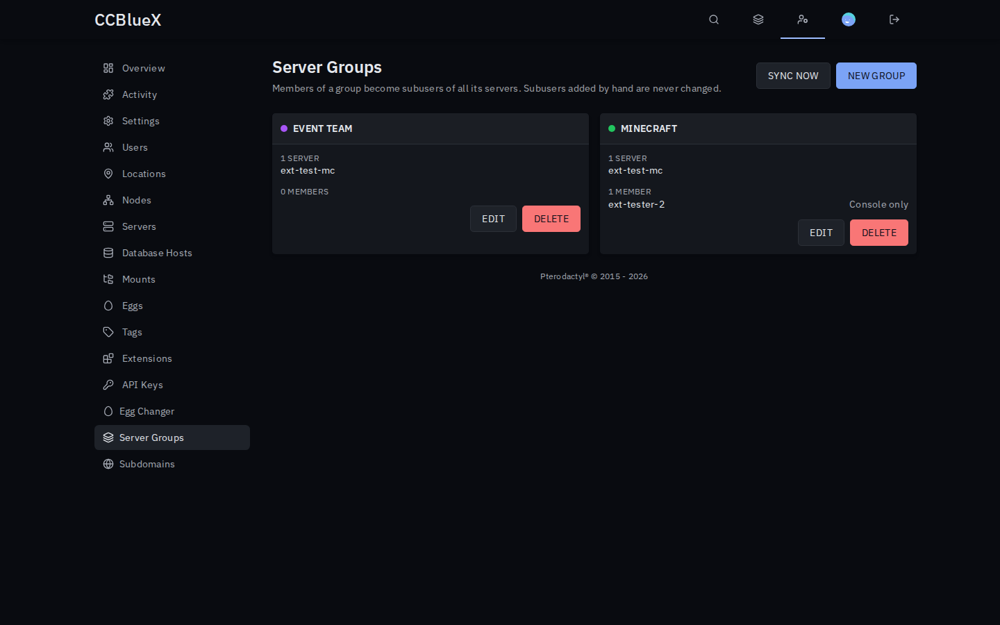
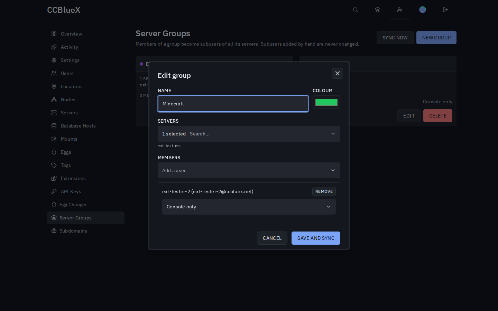
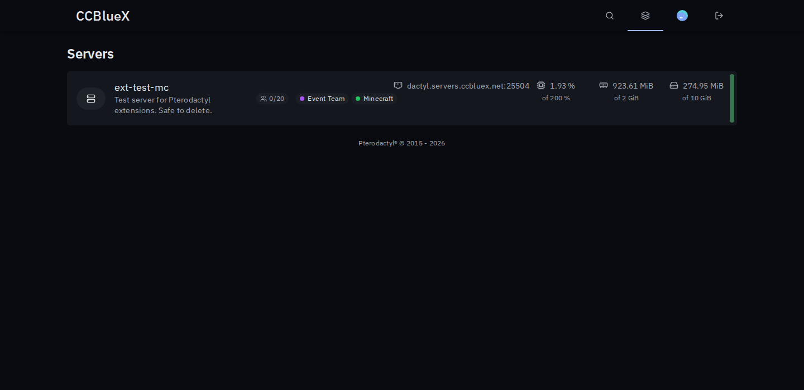

# Server Groups for Pterodactyl

Group servers, colour them on the dashboard and give a team access to a whole group at once.

## Install

1. Download `server-groups-<version>.pteroext` from the [latest release](https://github.com/1zun4/Pterodactyl-Extension-Server-Groups/releases/latest).
2. Install and enable it under **Admin → Extensions**.
3. Create your first group under **Admin → Server Groups**.

## Features

- **Team access**: group members become subusers of every server in the group, with a preset (Full access, Operator, Console only, Read only) or custom permissions.
- **Safe sync**: only subusers the extension created are changed or removed. Subusers added by hand stay as they are.
- **Dashboard badges**: users see the groups of their servers next to each server.
- **Account page**: **Account → Server Groups** lists a user's servers by group.
- **Admin column**: the admin server list shows each server's groups.

Access is synced on every save, with **Sync now**, and once a day (`php artisan server-groups:sync`).

---

Inspired by the Pelican plugin Server Groups.
